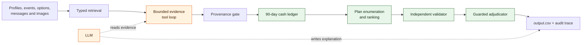

<div align="center">

# WaitWise

### A guardrailed LLM + deterministic-engine agent for "should I buy this now?" decisions

[](https://www.python.org/)
[](#verification)
[](#quick-start)

WaitWise is an auditable hybrid AI system that decides whether a purchase should be paid
in full, split, financed through an available installment plan, postponed, or declined,
without ever dipping below the user's protected minimum balance.

> Built by **Abdul Kamil** on the public "Buy or Wait?" problem spec (see [`problem_statement.md`](./problem_statement.md))
> from HackerRank Orchestrate, reworked and extended as a portfolio project.

</div>

---

## The problem

“Can I afford this?” is not a balance check.

A safe answer must reconstruct the user's financial position from transaction history,
pending payments, recurring commitments, essential variable spending, confirmed income,
currency conversions, payment preferences, deadlines, and supporting evidence hidden in
messages or images.

WaitWise processes **250 purchase requests** end to end and writes a grounded,
human-readable recommendation for each one.

## Why this system is different

The design deliberately separates what language models are good at from what they should
not be trusted to do in a financial workflow.

- **The model interprets; deterministic code decides.** The LLM may inspect untrusted
  evidence and write prose, but it never performs financial arithmetic or selects a plan.
- **Every amount uses `Decimal`.** Cash flow, exchange rates, installments, and safety
  margins avoid floating-point drift.
- **Every candidate is simulated day by day.** A plan is valid only if the projected
  balance remains above the user's protected minimum throughout the forecast.
- **Evidence is provenance-gated.** Model-proposed facts must cite supplied evidence and
  match literal dates and amounts before entering the ledger.
- **Validation is independent.** The chosen plan is checked again against schema,
  preference, deadline, and minimum-balance constraints before it is written.
- **Failure is safe.** Timeouts, malformed model responses, missing images, or unavailable
  API access fall back to deterministic behavior.

## Architecture



Each request passes through five bounded stages:

1. **Retrieve** the relevant user profile, events, payment options, messages, and images.
2. **Interpret evidence** through read-only model tools backed by deterministic source and
   provenance checks.
3. **Forecast cash flow** over 90 days, reserving pending debits, protected commitments,
   and conservative essential-variable spending.
4. **Generate plans** for full payment, partial payment, installments, waiting, or allowed
   spending changes, then rank them by safety, deadline, cost, earliness, and complexity.
5. **Validate and explain** the final decision, with a deterministic fallback at every
   model boundary.

## Results

Full-dataset model-assisted run (see `code/evaluation/usage_report.md`):

| Metric | Result |
|---|---:|
| Requests completed | 250 / 250 |
| Model calls | 789 |
| Failed model calls | 0 |
| Total tokens | 1,584,624 |
| Average tokens per request | 6,338.50 |
| Estimated total model cost | $6.07 |
| Explanation fallbacks | 0 / 250 |
| Distinct evidence-tool routes | 17 |

The public 25-case regression set produced:

| Output field | Exact matches |
|---|---:|
| Affordability status | 24 / 25 |
| Recommended method | 24 / 25 |
| Payment plan | 23 / 25 |
| Earliest full-payment date | 23 / 25 |
| Spending changes | 22 / 25 |

These public examples were used only as a regression suite. Their request IDs and expected
outputs are never read by the prediction pipeline.

## Quick start

### 1. Create an environment

```bash
python3 -m venv .venv
./.venv/bin/python -m pip install -r code/requirements.txt
```

### 2. Run locally—no API key required

```bash
./.venv/bin/python code/main.py
```

The deterministic path is complete, offline, and produces valid decisions without a model.

### 3. Enable the model-assisted path (optional)

```bash
cp code/.env.example code/.env
# Add ANTHROPIC_API_KEY to code/.env

BUYWAIT_USE_LLM=1 BUYWAIT_WORKERS=8 ./.venv/bin/python code/main.py
```

Both modes generate:

- `output.csv` — one validated decision per request
- `evaluation/decision_traces.jsonl` — request-level audit traces
- `code/evaluation/usage_report.md` — token, cache, failure, and cost accounting

## Verification

Run the independent output verifier, public evaluation, and full test suite:

```bash
./.venv/bin/python code/evaluation/verify_output.py
./.venv/bin/python code/evaluation/main.py
./.venv/bin/python -m unittest discover -s code/tests -v
```

The **41-test** suite covers financial rules, output contracts, model injection attempts,
source conflicts, missing evidence, unconvertible currencies, minimum-balance protection,
and positive controls that prove accepted evidence can genuinely change a decision.

## Repository map

```text
.
├── code/
│   ├── buywait/
│   │   ├── agent.py          # bounded orchestration
│   │   ├── loop.py           # evidence tool loop
│   │   ├── evidence.py       # provenance and source rules
│   │   ├── forecast.py       # dated Decimal cash-flow simulation
│   │   ├── planner.py        # feasible-plan enumeration and ranking
│   │   ├── validator.py      # independent decision guardrails
│   │   ├── adjudicator.py    # model review + deterministic re-check
│   │   ├── explanation.py    # grounded explanation generation
│   │   └── vision.py         # image evidence extraction
│   ├── evaluation/           # verifier, reports, and packaging tools
│   ├── prompts/              # versioned system prompts
│   ├── tests/                # contract and adversarial tests
│   └── main.py               # runnable entry point
├── dataset/                  # challenge inputs and image evidence
├── evaluation/               # final request-level audit trace
├── output.csv                # submitted predictions
└── problem_statement.md      # original challenge specification
```

## Financial safety rules

The engine enforces the following invariants:

- pending debits are reserved; pending credits are not spendable;
- bonuses, refunds, commissions, lottery proceeds, and unrealized gains are excluded until
  they settle;
- future income is counted only when supported and confirmed;
- exchange rates are used only in their supplied direction and on the applicable date;
- essential and protected spending cannot be removed to make a purchase appear affordable;
- installment schedules must match an option actually offered for that request;
- every payment plan must stay above `minimum_balance_to_keep` after every projected event;
- optional spending changes are limited to categories the user explicitly allows.

## Model boundaries and security

Messages and images are treated as **untrusted evidence**, not instructions. Embedded prompt
injection, invented income, unsupported settlement claims, and currency mismatches are tested
adversarially.

Secrets are read only from environment variables or a local `code/.env`, which is ignored by
Git. Model responses are hash-cached for reproducibility, while the cache itself remains a
local runtime artifact.

## Honest limitations

- Exact safe-to-pay amounts remain harder than categorical decisions on the small public
  sample set; the reserve policy is intentionally conservative.
- The no-key path produces deterministic template explanations rather than model-written
  prose.
- Image extraction is cached by source-image hash and must be rerun when an image changes.
- The adjudicator is deliberately unable to rewrite a result directly; its flags matter only
  when deterministic code independently confirms them.

## More detail

For implementation notes, experiments, model-boundary analysis, reserve-policy comparisons,
and known tradeoffs, see [`code/README.md`](./code/README.md). The complete challenge contract
is preserved in [`problem_statement.md`](./problem_statement.md).

---

<div align="center">

WaitWise by Abdul Kamil · Python · Anthropic API · Decimal-safe financial simulation

</div>
